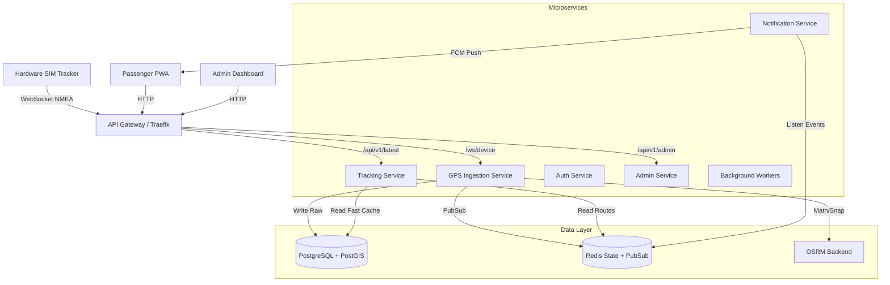
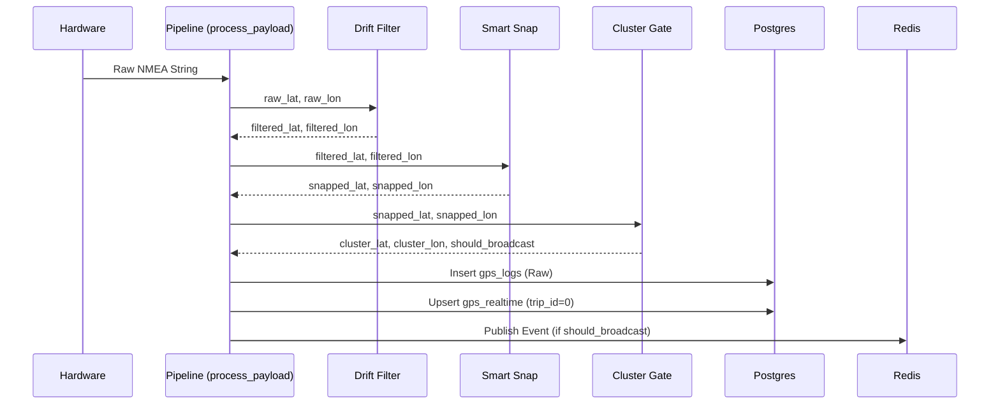

# DUK Bus Tracker — Complete System Architecture & Deep Dive

## Table of Contents
1. [Executive Summary](#1-executive-summary)
2. [High-Level Architecture](#2-high-level-architecture)
3. [Technology Stack](#3-technology-stack)
4. [Microservices Breakdown](#4-microservices-breakdown)
5. [Database Architecture & Schema](#5-database-architecture--schema)
6. [Hardware & Network Ingestion Flow](#6-hardware--network-ingestion-flow)
7. [The GPS Processing Pipeline (Step-by-Step)](#7-the-gps-processing-pipeline)
8. [Caching & State Management (Redis)](#8-caching--state-management)
9. [Smart Snapping Engine (Math + OSRM)](#9-smart-snapping-engine)
10. [Real-time Broadcast & PWA Consumption](#10-real-time-broadcast--pwa-consumption)
11. [Historical Trips & Trace Geometry](#11-historical-trips--trace-geometry)
12. [Authentication & Authorization Flow](#12-authentication--authorization-flow)
13. [Push Notification Engine (FCM)](#13-push-notification-engine)
14. [Background Workers & Cleanup](#14-background-workers--cleanup)
15. [Admin & Fleet Management](#15-admin--fleet-management)
16. [Deployment & Infrastructure](#16-deployment--infrastructure)
17. [Fault Tolerance & Error Recovery](#17-fault-tolerance--error-recovery)

---

## 1. Executive Summary
The DUK Bus Tracker is an ultra-low-latency, real-time tracking platform designed specifically for high-frequency public transit tracking. Unlike standard vehicle trackers that poll every 30-60 seconds, this system processes sub-10 second pings. To achieve this without burning database or CPU resources, it employs an event-driven microservices architecture, heavy in-memory Redis caching, and a highly optimized OSRM (Open Source Routing Machine) snapping engine to ensure the bus icon smoothly travels on correct road geometries.

---

## 2. High-Level Architecture

The system follows a strict event-driven microservices pattern routed through Traefik (or a custom API Gateway) to route HTTP and WebSocket traffic.



---

## 3. Technology Stack

### Backend Engine
* **Python 3.11:** The core language for all microservices. Chosen for its immense ecosystem, async capabilities, and spatial libraries.
* **FastAPI:** Used across all microservices for ultra-fast, async HTTP and WebSocket endpoints.
* **SQLAlchemy 2.0 (Async):** The ORM handling all Postgres connections safely without blocking the event loop.
* **Alembic:** Database migration management.
* **Uvicorn:** The ASGI web server running the FastAPI apps.

### Data Storage & Caching
* **PostgreSQL 15+:** The primary relational database.
* **PostGIS Extension:** Enables spatial indexing and fast coordinate-based bounding box queries (`ST_DistanceSphere`, `ST_MakePoint`).
* **Redis 7:** Serves a dual purpose:
  * **State Store:** Holds the fast-changing variables for the GPS drift filter (EMA values) and cluster gate.
  * **Event Bus (Pub/Sub):** Routes messages between `gps-ingestion` and `notification-service`.

### Routing & Geometry
* **OSRM (Open Source Routing Machine):** A highly performant routing engine written in C++. It holds the road network graph in RAM and calculates snapped road coordinates in less than 5ms.

### Frontend
* **React + Vite:** The PWA framework for ultra-fast HMR and small bundle sizes.
* **TailwindCSS:** Utility-first styling.
* **Leaflet / React-Leaflet:** The mapping engine rendering the custom tiles and GeoJSON traces.
* **Workbox:** Service worker generation for offline PWA caching.

---

## 4. Microservices Breakdown

The monolith repository `duk_micro` is split into distinct logical domains. They can be scaled independently using Docker Compose profiles.

### 4.1 GPS Ingestion (`services/gps-ingestion`)
The most complex service. It maintains persistent WebSocket connections with the hardware. It acts as a firewall, aggressively rejecting bad GPS data, mathematically snapping coordinates, and then fanning out the cleaned data to databases and Redis.

### 4.2 Tracking Service (`services/tracking-service`)
A purely read-only API designed for high-throughput. When 5,000 students open the app simultaneously at 4:30 PM, this service handles the load by serving data directly from memory (Redis) or the heavily indexed `gps_realtime` sentinel row.

### 4.3 Notification Service (`services/notification-service`)
A background consumer. It establishes a persistent connection to Redis Pub/Sub, listening to the `bus:snapped` or `bus:approaching` channels. It evaluates geofences and pushes Firebase FCM alerts.

### 4.4 Admin Service (`services/admin-service`)
Standard CRUD API for operators to create routes, schedule trips, assign drivers, and review logs.

### 4.5 Auth Service (`services/auth-service`)
Handles JWT issuance and verifies Google OAuth tokens. Exposes endpoints to refresh tokens and validate sessions.

### 4.6 Background Workers (`services/background-workers`)
Cron-like service. Handles tasks like cleaning up traces older than 24 hours, archiving partitioned logs, and resetting daily counters.

---

## 5. Database Architecture & Schema

The PostgreSQL database is heavily normalized but uses strategic denormalization for real-time reads.

### 5.1 The `gps_logs` Partitioned Table
Holds every raw ping ever received.
* **Partitioning Strategy:** Partitioned by month (e.g., `gps_logs_2026_09`). Prevents index bloat and allows instantaneous dropping of old data.
* **Critical Columns:** `server_time`, `gps_time`, `lat`, `lon`, `speed`, `source`.
* **Important Note:** NEVER use `ORDER BY id`. The `id` sequence resets or interweaves across partitions. Always use `ORDER BY server_time DESC`.

### 5.2 The `gps_realtime` Sentinel Table
The fastest table in the system. Holds exactly 1 row per active entity.
* **`trip_id=0` (The Sentinel):** Hardcoded row that ALWAYS contains the absolute latest physical coordinate of the hardware, regardless of what trip is running.
* **`trip_id=XYZ` (The Active Trip):** Populated via a Postgres trigger (`trigger_upsert_gps_realtime`). When a ping is inserted into `gps_logs` for an active trip, the database instantly mirrors it here.

### 5.3 The `trip_trace` Table
Holds the clean, visual path of the bus.
* **Purpose:** Instead of drawing 10,000 jagged raw points, this table stores segments of the journey that have been passed through OSRM.
* **`osrm_path` Column:** Stores the exact GeoJSON array `[[lon, lat], ...]` tracing the road curves between ping A and ping B.

### 5.4 Relational Tables
* `users`
* `buses` (hardware `device_id` mapping)
* `routes` (logical collection of stops)
* `stops` (lat/lon points)
* `route_stops` (junction table for ordering)
* `trips` (an instance of a bus driving a route on a specific date/time)

---

## 6. Hardware & Network Ingestion Flow

The hardware uses a Quectel (or similar) SIM module. It runs an AT command sequence to achieve GPS fix and open a TCP/WebSocket connection.

1. **Connection:** Hardware opens `ws://api.domain.com/api/v1/ws/device`.
2. **Authentication:** Hardware passes `?api_key=XYZ`.
3. **Payload Structure:** Hardware sends raw string: `+QGPSLOC: 103350.0,8.6156,76.8526,1.2,45.0,2,...`
4. **Resilience:** The WebSocket handler in FastAPI runs a constant `while True` read loop. If the connection drops (cellular dead zone), the server cleans up the socket. When the bus reconnects, it picks right back up.

---

## 7. The GPS Processing Pipeline

When `process_payload` receives the raw string, it passes through 5 distinct gates.



### Gate 1: Parser & Bounds Check
Extracts floats. Rejects immediately if lat/lon is outside the hardcoded service bounds (e.g., outside Kerala/India) to prevent 0,0 (Null Island) teleports.

### Gate 2: The Drift Filter (EMA)
GPS modules occasionally bounce 100 meters due to multi-path interference (bouncing off buildings).
* Calculates Haversine distance from the last known point.
* If jump > 2km in < 5 minutes -> **Reject (Ghost lock)**.
* Applies **Exponential Moving Average (EMA)** with an alpha of 0.7. `new_lat = 0.7*current + 0.3*previous`. This physically smooths the raw points before snapping.

### Gate 3: The Smart Snap
(See Section 9 for deep dive). Snaps to the road.

### Gate 4: The Cluster Gate
If the bus is stuck in traffic, it will ping the identical location 50 times. The cluster gate calculates distance from the last *broadcasted* point. If distance < 2 meters, it flags `should_broadcast = False`. The ping is still saved to the database for historical accuracy, but the WebSocket blast to 5,000 PWA clients is suppressed to save bandwidth.

### Gate 5: Persistence & Broadcast
Writes to Postges, writes to `trip_trace`, and publishes `bus:broadcast` to Redis.

---

## 8. Caching & State Management

Because the API handles thousands of concurrent requests, no state is kept in Python memory (which would break in multi-worker Gunicorn setups). All state lives in Redis.

* **`state:gps_filter:{device_id}`**: JSON dict containing `last_accepted_lat`, `smoothed_lat`, and `consecutive_rejections`.
* **`cache:route_geometry:{trip_id}`**: The fully pre-computed road line for the whole route.
* **`cache:route_history:{trip_id}`**: The 30-second TTL cache for the expensive stop-matching logic on the PWA history screen.

---

## 9. Smart Snapping Engine

Calling the OSRM C++ backend for every ping is fast, but doing it 100,000 times a day is unnecessary when we already know the route the bus is supposed to take.

We use a **2-Tier Smart Snapping Algorithm**:

### Tier 1: Math Snap (Zero Latency)
When a trip starts, the server queries OSRM once for the *entire* planned route and caches the thousands of coordinates in Redis.
When a live ping arrives, we run a fast Point-to-Line-Segment distance algorithm (Haversine cross-track) against the cached route.
If the bus is within 50 meters of the planned route, we mathematically snap the coordinate to the exact point on the line. **Network calls: 0.**

### Tier 2: OSRM Fallback (Deviations)
If the driver takes a detour, the Math Snap distance will exceed 50 meters.
The code detects this and dynamically falls back to an HTTP call to the local OSRM container: `/nearest/v1/driving/lon,lat`.
Crucially, we pass the `bearing` (calculated from the last two points) to OSRM. This forces OSRM to snap the bus to the correct lane on divided highways.

---

## 10. Real-time Broadcast & PWA Consumption

The PWA needs data fast. 
1. `tracking-service` subscribes to Redis `bus:broadcast`.
2. PWA maintains a WebSocket or uses HTTP Polling (fallback) to `/api/v1/latest`.
3. The `/api/v1/latest` endpoint does a highly optimized query:
   ```sql
   SELECT lat, lon FROM gps_realtime ORDER BY ist_time DESC, gps_time DESC LIMIT 1
   ```
   This takes ~2ms.

---

## 11. Historical Trips & Trace Geometry

The grey/blue trail drawn behind the bus is not a line connecting raw GPS dots. That would cross over buildings. 

The trail is generated continuously during the trip:
1. `process_payload` tracks the `last_trace_lat/lon`.
2. When the bus moves > 10 meters, it calls OSRM's `/route/v1/` endpoint between the last trace point and the current point.
3. OSRM returns a curved GeoJSON LineString that perfectly follows the road geometry.
4. This array is appended to the `osrm_path` column in `trip_trace`.
5. The PWA fetches `/api/v1/route_history` and simply renders the concatenated LineStrings.

---

## 12. Authentication & Authorization Flow

The app serves three types of users:
1. **Public/Students:** No authentication required to view the live map.
2. **Drivers/Staff:** Require Google OAuth.
3. **Admins:** Require Google OAuth + Admin flag in DB.

**Flow:**
1. Frontend redirects to Google.
2. Google returns profile payload to `/auth/google`.
3. `auth-service` verifies the Google JWT signature.
4. If valid, `auth-service` issues a custom RSA-signed JWT containing role claims.
5. All protected endpoints (Admin/Settings) check the `Authorization: Bearer <token>` header against the public key.

---

## 13. Push Notification Engine

We use Firebase Cloud Messaging (FCM) to alert students when the bus is 5 minutes away.

1. `notification-service` listens to Redis for every GPS ping.
2. It calculates the ETA to all upcoming stops using historical average speeds + OSRM distance.
3. If ETA < 5 minutes for Stop X, it checks a local Redis debounce cache (`notified:stop_X:trip_125`).
4. If not debounced, it triggers the Firebase Admin SDK to push a notification payload to the FCM Topic `stop_X`.
5. Phones subscribed to that topic wake up and display the notification.

---

## 14. Background Workers & Cleanup

The system generates massive amounts of data. A dedicated `background-workers` microservice runs APScheduler.

**Core Tasks:**
* **`trip_trace_cleanup_loop`**: Deletes `trip_trace` rows older than 24 hours to keep the table light. Traces are not needed for permanent storage, only for active/recent visualizations.
* **Status Updates**: Scans trips that have passed their `end_time` and forcefully marks them as `COMPLETED` if the hardware stopped pinging.

---

## 15. Admin & Fleet Management

The React Admin Dashboard interacts with `admin-service`. 
* **Data Integrity:** You cannot delete a Stop if a Route uses it (Foreign Key constraints).
* **Scheduling:** A `trip` is created by joining a `bus` (device_id), a `route` (geometry), and a `driver` (user_id) at a specific time.

---

## 16. Deployment & Infrastructure

The entire architecture is containerized using Docker.

**Deployment Script (`push_to_server.sh`):**
1. Uses `rsync` to sync the local folder to the production Ubuntu server (excluding `node_modules`, `__pycache__`, etc).
2. SSH's into the server.
3. Runs `docker-compose up -d --build`.
4. Runs `alembic upgrade head` to apply any database schema changes safely.

**OSRM Container:**
The OSRM backend runs its own container, loading a `.osrm` pre-compiled map file of the specific state/city. This ensures routing requires zero external internet calls to Google/Mapbox, saving thousands of dollars in API fees.

---

## 17. Fault Tolerance & Error Recovery

### Ghost Lock Recovery
If the GPS drift filter accidentally locks onto a bad coordinate and rejects 20 consecutive real pings, the filter will automatically detect the anomaly, log a `CRITICAL` warning, clear the Redis state, and accept the new point.

### Database Reconnects
SQLAlchemy async pools are configured with `pool_pre_ping=True`. If the database restarts, the microservices will not crash; they will silently re-establish connections on the next ping.

### Hardware Dead Zones
If a bus enters a tunnel, the WebSocket closes. The PWA calculates `is_live` by comparing the server's UTC time to the last `ist_time` or `gps_time`. If the delta is > 120 seconds, the frontend icon turns grey to indicate signal loss to the user.

---
*End of Document. Maintained by the Core Infrastructure Team.*
