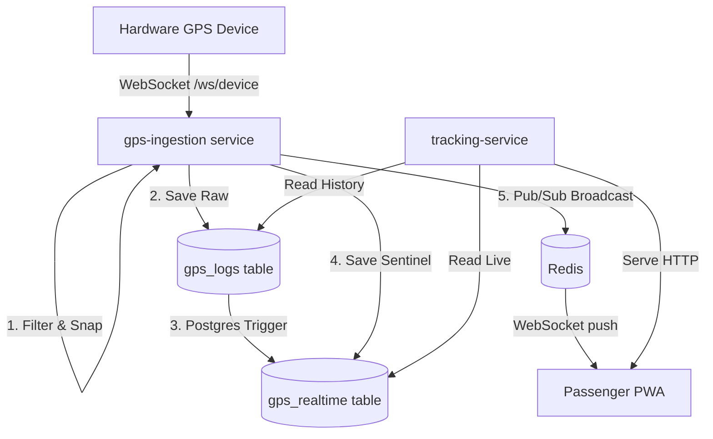

# DUK Bus Tracker

The DUK Bus Tracker is a real-time hardware-to-frontend tracking system designed to monitor campus bus fleets. It ingests raw GPS signals from hardware modules, mathematically snaps them to road geometries using OSRM, and pushes live location data to a React Progressive Web App (PWA) in under 100 milliseconds.

## 🏗 System Architecture

The project is built on an event-driven microservices architecture using FastAPI, Redis, Postgres/PostGIS, and Docker.

## 📂 Repository Structure & Microservices

The repository is divided into four main projects:

1. **`duk_micro/` (Backend Microservices):**
   * **`gps-ingestion/`**: Handles the raw WebSocket connections from the buses. Filters impossible GPS jumps and uses OSRM to snap coordinates to valid road paths.
   * **`tracking-service/`**: The HTTP API serving the frontend PWA. Computes ETAs, serves live positions, and caches route geometries.
   * **`auth-service/`**: Handles Google OAuth and user JWT token generation.
   * **`admin-service/`**: Backend for the admin dashboard (manages bus schedules and routes).
   * **`notification-service/`**: Listens for Redis events and sends Firebase Cloud Messaging (FCM) push notifications when a bus nears a stop.
   * **`background-workers/`**: Cleans up stale traces and runs analytics tasks.
2. **`duk_pwa1/` (Frontend App):** React + Vite PWA used by passengers.
3. **`admin-dashboard/` (Admin Panel):** React app used by operators to manage the fleet.
4. **`duk_bus_website/`:** Static landing page for the project.

## 🔗 File Connections & Data Flow

Understanding how data flows between files is critical for development:

*   **Ingestion Entry Point:** `duk_micro/services/gps-ingestion/main.py`
    *   `@app.websocket("/api/v1/ws/device")` receives raw NMEA data from the SIM tracker.
    *   `process_payload()` parses the string, saves to `gps_logs`, and UPSERTs `gps_realtime` with a `trip_id=0` sentinel row.
*   **Database Trigger:** A PostgreSQL trigger (`trigger_upsert_gps_realtime`) watches `gps_logs`. When a ping arrives for an active trip (e.g. `trip_id=125`), the trigger automatically copies it to `gps_realtime` under that `trip_id`.
*   **Frontend Consumption:** `duk_micro/services/tracking-service/main.py`
    *   `/api/v1/latest` queries `gps_realtime` to instantly find the absolute latest ping.
    *   `/api/v1/trip_state` queries `gps_realtime` for a specific active trip to compute ETAs and stop arrivals.

## 🚀 Deployment

Deployment to production is entirely automated via bash.

1. Ensure your server SSH keys are configured.
2. Run `./push_to_server.sh` from the repository root.
3. The script will zip the workspace, upload it to the server, rebuild Docker Compose, and apply Alembic migrations automatically.

## 🛠 Local Setup

All sensitive credentials have been scrubbed from `.env` files for security. Before running locally:
1. Populate `duk_micro/.env` (Database URIs, Redis URI, Firebase keys, Google OAuth IDs).
2. Populate `duk_pwa1/.env`, `.env.production`, and `.env.development`.
3. Start the backend: `cd duk_micro && docker-compose up --build`
4. Start the frontend: `cd duk_pwa1 && npm run dev`
